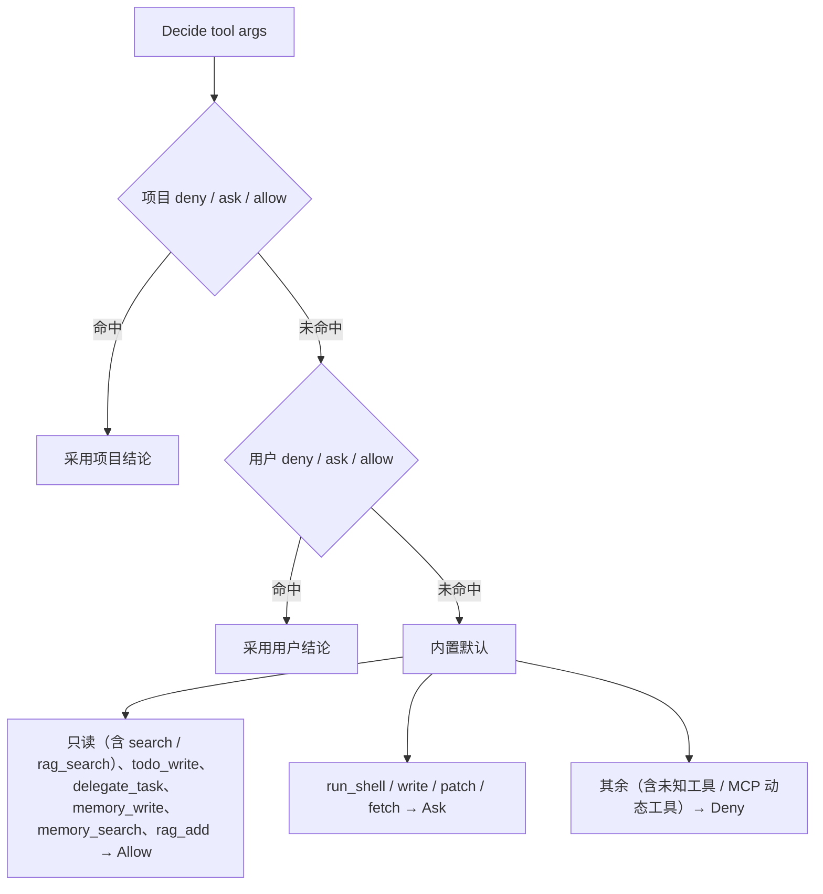

# permission 模块：功能逻辑

代码：`internal/permission/`（Day 8）

## 职责

- **工具权限策略**：对每次工具调用给出 `Allow` / `Ask` / `Deny`。
- **路径越界检查**：`SafePath` 保证文件类工具只读写工作区内的路径（含符号链接解析）。
- **输出脱敏**：`Redact` 把密钥类字符串替换为 `***`。

本包**不依赖 `tools`**。REPL 把 `Policy.Decide`、`SafePath`、`Redact` 包成闭包，经 `tools.SetPolicy` / `SetPathGuard` / `SetRedactor` 注入。

## 配置文件

两份同格式的文件，项目规则优先：

- 项目：工作区 `.geekagent/GeekAgent.json`（随 `.geekagent/` 不入库）
- 用户：`~/.hi-agent/GeekAgent.json`

```json
{ "permissions": {
    "allow": ["read", "run_shell:go test*"],
    "ask":   ["write"],
    "deny":  ["run_shell:rm *"]
} }
```

- 规则写法：`工具名` 或 `工具名:通配`；工具名可写 `*` 匹配任意工具。
- 通配对**参数主体**匹配：`run_shell` 取 `command`，`glob` / `search` 取 `pattern`，`fetch` 取 `url`，其余取 `path`（`\` 统一为 `/`）。
- 通配语法：`*` 匹配任意串（可跨 `/`），`?` 匹配单个字符。

## 判定流程



MCP 工具名形如 `mcp_<server>_<tool>`，默认不在内置策略表中，因此**默认 deny**。需要在使用前写入项目或用户 `GeekAgent.json`，例如：

```json
{ "permissions": { "allow": ["mcp_filesystem_read_file", "mcp_*"] } }
```

权限判定仍由 `tools.Exec` 统一完成，MCP 客户端不会绕开 Day 8 钩子。

## API

| 函数 | 说明 |
|------|------|
| `Load(root)` | 合并项目与用户两份配置。某一层不存在则该层为空；JSON 损坏则该层忽略并返回错误，另一层仍生效 |
| `Default()` | 仅内置默认 |
| `(*Policy).Decide(tool, argsJSON)` | 返回 `Decision` |
| `(*Policy).Lines()` | `/permissions` 展示用：配置来源、各级规则、内置默认 |
| `Subject(tool, argsJSON)` | 取规则匹配的参数主体：`run_shell`→command、`glob`/`search`→pattern、`fetch`→url、`rag_add` 及其余→path |
| `Wildcard(pattern, s)` | 通配匹配 |
| `SafePath(root, p)` | 相对路径按 `root` 拼接；解析符号链接（目标不存在时解析最近的已存在祖先）；结果不在 `root` 内返回「路径越界」 |
| `Redact(s, secrets...)` | 替换：显式传入的密钥原值（≥6 字符）、`sk-…`、`Bearer xxx`、`*_API_KEY=` / `*_TOKEN=` / `*_SECRET=` 后的值 |

## 边界

- Windows 下路径比较大小写不敏感（`filepath.Rel` 语义）。
- 脱敏是尽力而为的模式匹配，不保证覆盖所有密钥格式。
- 项目规则可以覆盖用户级。REPL 同时看两个文件的修改时间，变了就重载。
