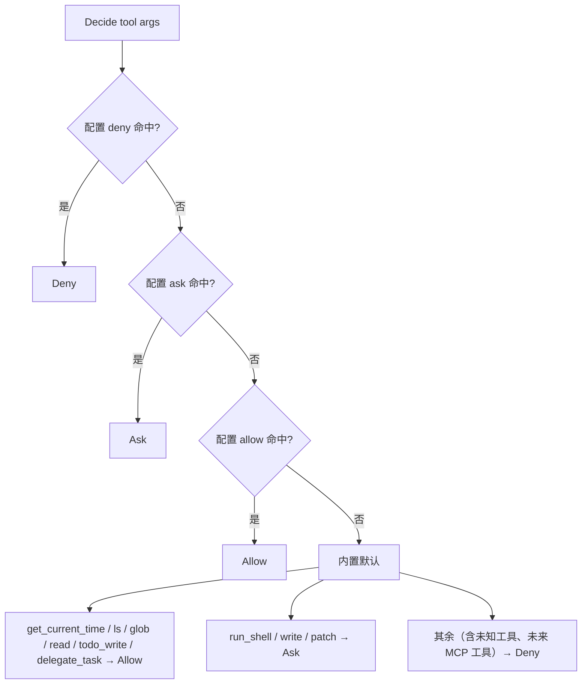

# permission 模块：功能逻辑

代码：`internal/permission/`（Day 8）

## 职责

- **工具权限策略**：对每次工具调用给出 `Allow` / `Ask` / `Deny`。
- **路径越界检查**：`SafePath` 保证文件类工具只读写工作区内的路径（含符号链接解析）。
- **输出脱敏**：`Redact` 把密钥类字符串替换为 `***`。

本包**不依赖 `tools`**。REPL 把 `Policy.Decide`、`SafePath`、`Redact` 包成闭包，经 `tools.SetPolicy` / `SetPathGuard` / `SetRedactor` 注入。

## 配置文件

工作区根目录下 `.geekagent/GeekAgent.json`（随 `.geekagent/` 不入库）：

```json
{ "permissions": {
    "allow": ["read", "run_shell:go test*"],
    "ask":   ["write"],
    "deny":  ["run_shell:rm *"]
} }
```

- 规则写法：`工具名` 或 `工具名:通配`；工具名可写 `*` 匹配任意工具。
- 通配对**参数主体**匹配：`run_shell` 取 `command`，`glob` 取 `pattern`，其余取 `path`（`\` 统一为 `/`）。
- 通配语法：`*` 匹配任意串（可跨 `/`），`?` 匹配单个字符。

## 判定流程



## API

| 函数 | 说明 |
|------|------|
| `Load(root)` | 读配置；文件不存在返回默认策略；JSON 损坏返回默认策略 + 错误（调用方提示后继续） |
| `Default()` | 仅内置默认 |
| `(*Policy).Decide(tool, argsJSON)` | 返回 `Decision` |
| `(*Policy).Lines()` | `/permissions` 展示用：配置来源、各级规则、内置默认 |
| `Subject(tool, argsJSON)` | 取规则匹配的参数主体 |
| `Wildcard(pattern, s)` | 通配匹配 |
| `SafePath(root, p)` | 相对路径按 `root` 拼接；解析符号链接（目标不存在时解析最近的已存在祖先）；结果不在 `root` 内返回「路径越界」 |
| `Redact(s, secrets...)` | 替换：显式传入的密钥原值（≥6 字符）、`sk-…`、`Bearer xxx`、`*_API_KEY=` / `*_TOKEN=` / `*_SECRET=` 后的值 |

## 边界

- Windows 下路径比较大小写不敏感（`filepath.Rel` 语义）。
- 脱敏是尽力而为的模式匹配，不保证覆盖所有密钥格式。
- 不做多级策略继承（用户级 / 项目级合并），只读项目内一个文件。
