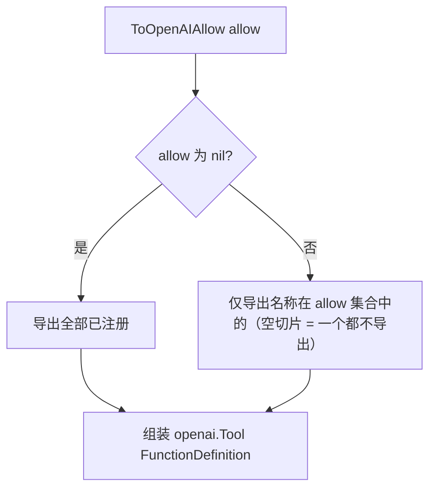
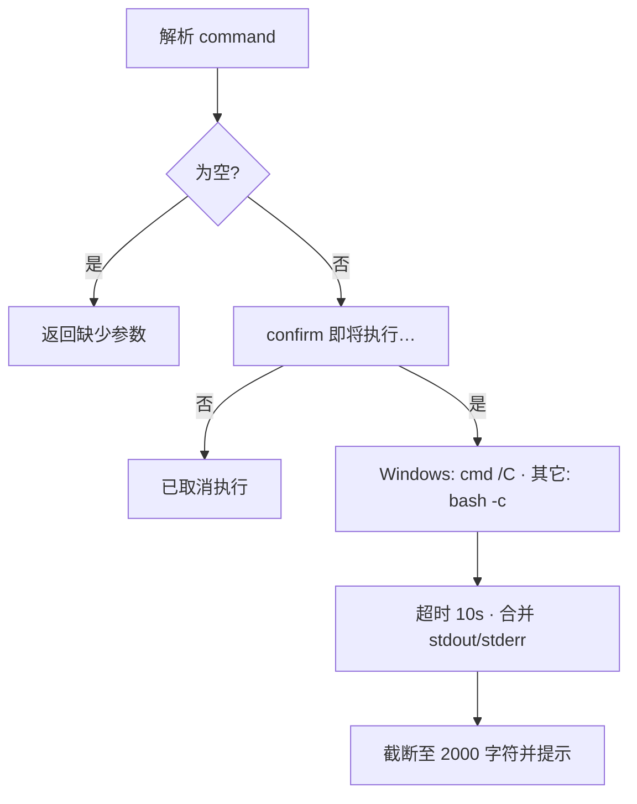
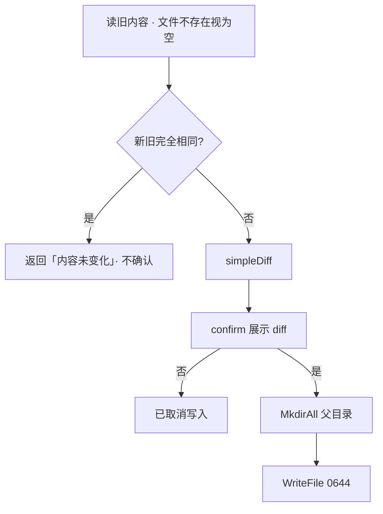
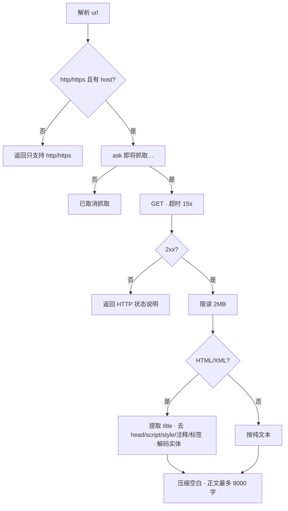

# tools — 功能逻辑

## 1. 职责

维护进程内工具注册表：声明说明书（供模型选工具）、按名执行、转为 OpenAI `tools` 参数；可选注入「危险操作确认」。  
chat 模块只通过本包的注册表 API 与模型交互，**禁止**在循环里硬编码工具列表。

## 2. 代码位置

| 文件 | 内容 |
|------|------|
| `tools.go` | `Tool`、`Register`、`ToOpenAI` / `ToOpenAIAllow`、`Exec`、`Names`、`ReadonlyNames`、`init` |
| `confirm.go` | `ConfirmFn`、`SetConfirm`（默认拒绝） |
| `time.go` | `get_current_time` |
| `shell.go` | `run_shell` |
| `files.go` | `ls` / `glob` / `read` / `write` / `patch` 与 diff 落盘 |
| `hooks.go` | `Decision`、`SetPolicy` / `SetPathGuard` / `SetRedactor`、`SetDelegator`、`execMu` / `preApproved`、`ExecContext` |
| `undo.go` | `.geekagent/undo.json` 最多 20 条的文件撤销栈、`UndoLast` |
| `plan_tool.go` | `todo_write` |
| `delegate.go` | `delegate_task` |
| `memory.go` | `memory_write` / `memory_search` |
| `search.go` | `search`（工作区按行搜索，纯 Go） |
| `fetch.go` | `fetch`（确认后抓网页并转纯文本） |

## 3. 核心抽象

```go
type Tool struct {
    Name        string
    Description string
    Parameters  any                    // JSON Schema 风格 map，交给 SDK
    Run         func(argsJSON string) (string, error)
}
```

- 新增工具必须 `Register`；重名或空名 → **panic**（启动期失败，避免静默丢工具）。  
- 各文件 `init` 分别注册；内置工具含：`get_current_time`、`run_shell`、`ls` / `glob` / `read` / `write` / `patch`、`todo_write`、`delegate_task`、`memory_write` / `memory_search`、`search`、`fetch`。
## 4. 注册表 API 流程

### 4.1 `Register`

加锁 → 查重 → 追加 `registry`。

### 4.2 `ToOpenAI` / `ToOpenAIAllow`



`ToOpenAI()` ≡ `ToOpenAIAllow(nil)`。

### 4.3 `ReadonlyNames`

只读集合（写死）：`get_current_time`、`ls`、`glob`、`read`、`search`。  
返回 **已注册 ∩ 只读集合**（顺序随 registry）。  
chat 收缩工具集时用：`ToOpenAIAllow(ReadonlyNames())`。

未列入只读：`run_shell`、`write`、`patch`、`fetch`（联网，默认 ask）。

### 4.4 `Exec(name, argsJSON) string`

面向模型的**字符串结果**（错误也写成文本，不抛给循环）：

| 情况 | 返回示例 |
|------|----------|
| 未知工具 | `未知工具：xxx` |
| `argsJSON == ""` | 按 `"{}"` 继续 |
| 非法 JSON | `参数不是合法 JSON：…` |
| `Run` 返回 err | `工具执行失败：…` |
| 成功 | `Run` 的 string |

并发：读注册表用 `RLock`；执行在锁外，避免慢工具堵注册。

---

## 5. 确认机制

```go
type ConfirmFn func(prompt string) bool
func SetConfirm(fn ConfirmFn)  // fn==nil → 永久拒绝
```

| 默认 | 含义 |
|------|------|
| 未注入时 `confirm` 恒为 `false` | 取消执行（安全默认） |

REPL 启动时注入：读一行，`y` / `yes`（忽略大小写）为真。  
需要确认的工具：`run_shell`、`write`、`patch`（经 `commitWrite`）、`fetch`。  
`fetch` 在 `Run` 内调用 `ask()`：权限策略判为 `Allow` 时 `preApproved` 直接放行；`Ask` 时只弹一次确认；未注入 confirm 时默认拒绝。

---

## 6. 各工具逻辑

### 6.1 `get_current_time`

- 参数：无（空对象即可）。  
- 时区：`Asia/Shanghai`；Load 失败则用 `FixedZone("CST", +8h)`。  
- 格式：`2006/1/2 15:04:05`。  
- **免确认**。

### 6.2 `run_shell`



| 常量 | 值 |
|------|-----|
| 超时 | 10s |
| 输出上限 | 2000 字符（rune） |

超时/非零退出：仍把说明文本返回给模型（`Run` 层常返回 nil error + 说明串，或由 truncate 包装），保证循环可继续。

### 6.3 `ls`

- 参数：`path` 可选，默认 `.`。  
- 输出每行：`dir|file` + 名称。  
- 免确认。路径错误 → `Run` error → `Exec` 包装。

### 6.4 `glob`

- 参数：`pattern` 必填。  
- 从 `.` 起 Walk；**跳过名为 `.git` 的目录**。  
- 匹配：按路径段；`*` 用 `filepath.Match`；`**` 表示跨目录递归。  
- 最多 **200** 条；超出附加截断提示。  
- 无匹配：返回说明文案。免确认。

### 6.5 `read`

- 参数：`path` 必填；`offset` 可选（字符偏移，`<0` 当作 0）。  
- 单次最多约 **8000** 字符；若还有后续，提示下次 `offset`。  
- 免确认。

### 6.6 `write` / `patch` → `commitWrite`

**write**：`path` + `content` → 直接进入 `commitWrite`。

**patch**：

1. 读出原文件（不存在则失败）。  
2. 对每个 hunk：`old` 在全文中必须 **恰好出现 1 次**；否则失败并说明。  
3. 按顺序 `strings.Replace(..., old, new, 1)`。  
4. 得到新全文后进入 `commitWrite`。

**commitWrite 流程**：



**simpleDiff**：

- 按行比较，去掉公共最长前缀行与后缀行。  
- 输出 `-` 旧 / `+` 新风格文本。  
- 最多 **100** 行差异展示，超出截断提示。

### 6.7 `todo_write` / `delegate_task`（Day 9）

- `todo_write`：按 id 合并当前会话的任务清单（`internal/plan`），写完立即落盘。同时最多一项 `in_progress`。
- `delegate_task`：调用 REPL 注入的 `SetDelegator`。子对话能看主 history、能用工具，但只能一层；再委派返回「不能再委派」。执行前放开 `execMu`，避免子工具死锁。无注入时返回「委派未配置」。停止按钮取消的是同一个 context。
- `memory_write` / `memory_search`：追加和子串搜索项目长期记忆，最多返回 5 条。
- 这些工具默认 allow。deny 时 `Exec` 直接拒绝，不会进入 `Run`。

### 6.8 `search`（Day 12）

- 参数：`pattern` 必填；`path` 可选（文件或目录，默认 `.`）；`regex` 可选（默认 `false`）。
- 纯 Go `filepath.WalkDir`，**不调用 ripgrep**。字面匹配区分大小写；`regex: true` 时按 Go 正则（RE2）编译。
- 跳过目录：`.git`、`.geekagent`、`node_modules`、`dist`、`build`、`.next`、`.venv`、`venv`、`__pycache__`。
- 跳过含 NUL 的二进制文件、超过 2MB 的文件和符号链接；单个路径读失败只跳过该路径。
- 输出 `相对路径:行号: 行内容`；单行最多 240 rune，最多 200 条，超出提示收窄 `pattern` / `path`。
- `path` 经 PathGuard；**免确认**。

### 6.9 `fetch`（Day 12）



- 请求带固定 UA 与 `Accept`；跟随重定向，输出最终 URL。
- 非 2xx、超时、网络错误都返回说明文本（`Run` 不抛 error），工具循环继续。
- 不执行 JavaScript、不处理登录/Cookie、不做非 UTF-8 转码；正文可能包含导航等噪声。
- 默认权限 `ask`；`fetch` 内部 `ask()` 在策略为 `Allow` 时免确认，`Ask` 时只弹一次。

---

## 7. 与 chat 的协作

| chat 行为 | tools API |
|-----------|-----------|
| 正常轮 | `ToOpenAIAllow(技能白名单)`（未加载技能时为 `nil` → 全部） |
| 收缩轮 | 白名单 ∩ `ReadonlyNames()`；无白名单时直接 `ToOpenAIAllow(ReadonlyNames())` |
| 执行 | `ExecContext(ctx, name, args)`（`Exec` 无 ctx 包装）—— 结果整段进 `role=tool` 与进度行 |
| REPL 启动 | `SetConfirm(...)`；`SetDelegator` → `chat.Delegate` |

工具内部**不感知**轮次上限、重复熔断、预算；那些在 chat。

## 8. Day 8 钩子：权限、路径、脱敏、撤销（`hooks.go` / `undo.go`）

tools **不依赖** `internal/permission`，只暴露钩子，由 REPL 注入：

| 钩子 | 作用 | 未注入时 |
|------|------|----------|
| `SetPolicy(func(name, args) Decision)` | `Allow` / `Ask` / `Deny` | 一律 `Ask`（原行为） |
| `SetPathGuard(func(path) (string, error))` | `ls` / `read` / `write` / `patch` / `search` 使用路径前检查并转换 | 不检查 |
| `SetRedactor(func(string) string)` | `Exec` 返回值与确认提示先脱敏 | 原样 |

`Exec` 流程：未知工具 / 非法 JSON → 策略判定 → `Deny` 返回「已拒绝：权限策略不允许 <tool>」→ 否则加 `execMu` 执行 `Run`；`Allow` 时本次调用内 `ask()` 直接通过（`preApproved`），`Ask` 走 `confirm`。  
约束：`preApproved` 是调用级状态，依赖 `execMu` 串行化；chat 工具循环本就顺序执行。

撤销：`commitWrite` 在确认后、落盘前把 `{path(绝对), existed, oldContent}` 压入 `.geekagent/undo.json`，最多 20 条，丢掉最旧的。旧的单对象文件读入时当作只有一条。  
`UndoLast()`：栈空返回「没有可撤销的写入」；弹出最近一条，展示 diff 并 `confirm`（不受 `preApproved` 影响）；原本存在则写回旧内容，原本不存在则删除。不撤销 shell 的副作用。

## 9. 边界与非目标

- `run_shell` 的工作目录固定为当前工作区。命令文本里的绝对路径和以 `..` 开头的相对路径经 PathGuard，越界则拒绝。这不是操作系统沙箱：`subst`、环境变量展开等绕过挡不住。超时上下文用当前回复的 `callCtx`，停止可以取消正在跑的命令。
- `glob` 拒绝绝对路径和含 `..` 的 pattern；符号链接经 PathGuard，逃出工作区的跳过。
- `search` 同样只搜工作区内；搜索大仓库时靠 200 条上限提前结束，不建索引。  
- `fetch` 只接受 http/https，不阻止内网/本机地址；确认提示会带上完整 URL，用户应自行判断来源。  
- 撤销最多 20 步，不撤销 shell 副作用。  
- `patch` 不做模糊匹配；锚点必须唯一。  
- 技能工具白名单只影响 `ToOpenAIAllow` 的导出（模型看不到未列出的工具）；`Exec` 不按白名单额外拦截，越权调用仍由权限策略判定。
- Windows 下 `run_shell` 经 `cmd /C`，输出编码可能与控制台代码页有关（已知乱码风险，未在本阶段修）。

## 10. 依赖与调用方

| 方向 | 对象 |
|------|------|
| 外部 | `go-openai`（仅类型）、标准库 |
| 内部 | 无 |
| 调用方 | `internal/chat`、`cmd/hi-agent` |
